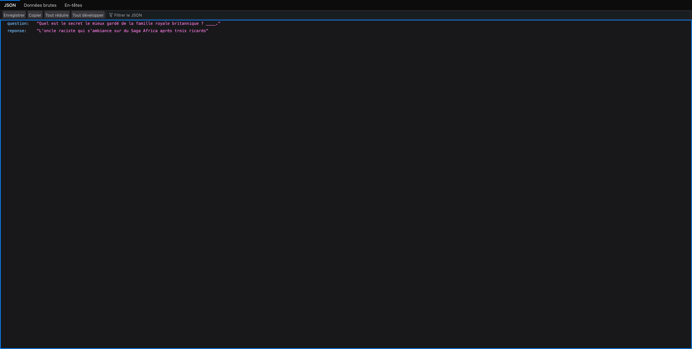

[](https://github.com/JustineB24/limite-limite/actions/workflows/ci.yml) [](https://github.com/JustineB24/limite-limite/actions/workflows/cd.yml)

# Limite Limite - API

Exercice de cours réalisé en binôme par **Justine B.** et **Thibaut G.**

Une API en PHP 8.2 qui tire au hasard une question à trou et une réponse du jeu Limite Limite, et les
renvoie en JSON. Les cartes sont stockées dans MySQL, le tout tourne dans Docker, et GitHub Actions
teste puis déploie le code à chaque push.

## Exemple de réponse

```bash
docker compose up -d --build
```

L'API répond ensuite sur [http://localhost:3000](http://localhost:3000) :



## Le code

- **PHP 8.2** en MVC léger, chargé par l'autoload PSR-4 de Composer.
- **MySQL 8.0** pour les cartes questions et réponses, initialisée par `data_db.sql`.
- Le contrôleur `LimiteLimite` reçoit ses dépendances par injection, ce qui permet de le tester avec des
  mocks.
- **PHPUnit 11** pour les tests, **PHP_CodeSniffer** pour vérifier le standard PSR-12.

## CI/CD avec GitHub Actions

Deux workflows, sur les branches `develop` et `prod`.

**ci**, à chaque push ou pull request :

1. installe PHP 8.2 et les dépendances Composer, avec cache
2. vérifie les failles connues des dépendances (`composer audit`)
3. contrôle le style PSR-12 (`phpcs`)
4. lance les tests (`phpunit`)

**cd**, quand `ci` est terminé : se connecte en SSH au VPS et met à jour le code dans `~/devapp`, puis
dans `~/prodapp` (`git pull`, ou `git clone` au premier passage).
